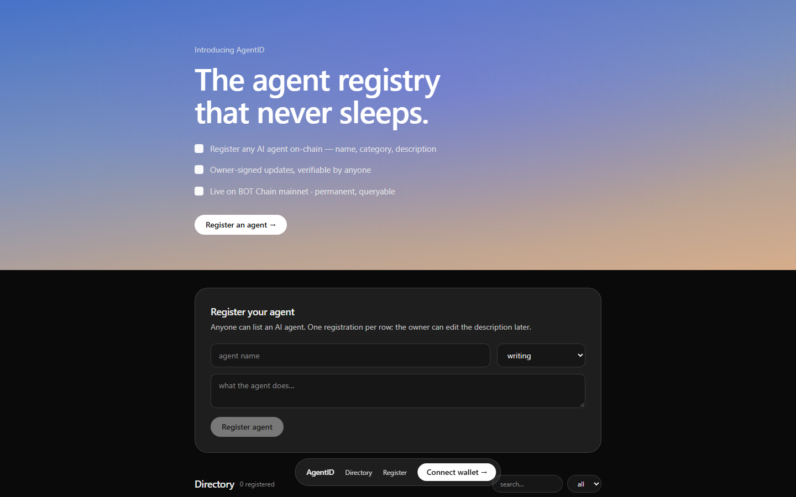
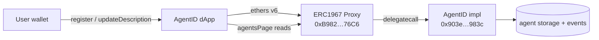

# AgentID

> An on-chain registry for AI agents on BOT Chain — anyone can list an agent by
> name, category and description, and anyone can look it up, forever.

[**▶ Live demo**](https://agentid.druxamb.dev/) ·
[Contract](https://scan.botchain.ai/address/0xB9826C48e938a78B5E927bb98e827A7d5e2767C6)
· [X/Twitter](https://x.com/agentidlive) · BOT Chain mainnet (chain 677)



## The problem

AI agents have no portable identity. An agent's name, specialty and owner live
inside whatever app happens to run it — there is no shared place to ask
"who built this, and what does it do?" that outlives any single frontend.

## What it does

- **Registers agents on-chain** — name, one of seven categories, and a
  description, stored permanently in contract storage.
- **Public directory** — the app lists every registered agent with category
  filters and text search, newest first.
- **Owner-only edits** — the wallet that registered an agent can update its
  description; nobody else can touch it.
- **Upgradeable without moving** — UUPS + ERC1967 proxy, so fixes and features
  ship without changing the contract address.

## How it works



The hard part isn't storage — it's keeping the address stable while staying
able to fix the contract. That's what the proxy buys: `deployed.json` records
impl + proxy, and only the owner (`0xaf59…C599`) can authorize an upgrade.

## Built with

| Layer | Choice | Why |
|---|---|---|
| Contract | Solidity 0.8.30, UUPS + Ownable (OpenZeppelin) | Stable address + owner-gated upgrades |
| Compile/deploy | solc-js + custom resolver, `scripts/deploy.mjs` | No Foundry needed — deploys impl + ERC1967 proxy in one command |
| Frontend | Next.js 16 (App Router) + TypeScript | Single-page dApp, static export |
| Wallet | Hand-rolled EIP-1193/EIP-6963 connector | No wagmi dependency — works with any injected wallet |
| Chain reads | ethers v6 `JsonRpcProvider` | Directory loads without connecting a wallet |
| Design | Dimension design system via Refero Styles | Dusk-gradient hero, frosted pills; see Design below |

## What's real vs. mocked

| Piece | Real? |
|---|---|
| Contract | Live on BOT Chain mainnet — `0xB9826C48e938a78B5E927bb98e827A7d5e2767C6` |
| Registration, edits, directory reads | All real chain calls |
| Wallet connect | Real (MetaMask or any EIP-6963 wallet) |
| Mocked data | None — an empty registry is just empty |

## Run it locally

```bash
git clone https://github.com/DruxAMB/AgentID.git && cd AgentID
cd app && npm install && npm run dev   # http://localhost:3000
```

No environment variables needed — the app defaults to BOT Chain mainnet.

To redeploy the contract yourself:

```bash
npm install                    # solc + ethers at the project root
cp .env.example .env           # set DEPLOYER_KEY + OWNER_ADDRESS
npm run compile                # compile check only
npm run deploy                 # deploys impl + proxy, rewrites app/src/lib/contract.ts
```

## Known limitations

- **One description field, no history** — edits overwrite; the chain records the
  event but the app doesn't render a change log.
- **No pagination UI** — the app loads the latest 200 agents; a bigger registry
  needs paged browsing.
- **No avatar/metadata standard** — agents are name + text only; linking
  external metadata (ERC-8004-style) is the obvious next step.
- **`updateDescription` gas cost scales with text** — long descriptions cost
  more to write; nothing enforces brevity beyond the 512-char UI cap.

## Licences

- This project: [MIT](LICENSE)
- OpenZeppelin Contracts (vendored under `contracts/lib/`): MIT
- Fonts — DM Sans and JetBrains Mono: SIL Open Font Licence
- Next.js, React, ethers: MIT

## Design

Visual language adapted from the **Dimension** design system via Refero Styles —
`https://styles.refero.design/style/fbcf9cbb-7c6b-449d-862a-bce521a8ab1d`
(dimension.dev — dusk-lit frosted-glass workspace). Palette, type and radii are
remapped onto semantic tokens in `app/src/app/globals.css`. Rules followed:
full-bleed amber→cobalt gradient hero, bottom-center floating nav pill, white
pill CTA, hairline borders with no shadows, headings never above weight 500,
violet only as a decorative wash — never on controls or text.
